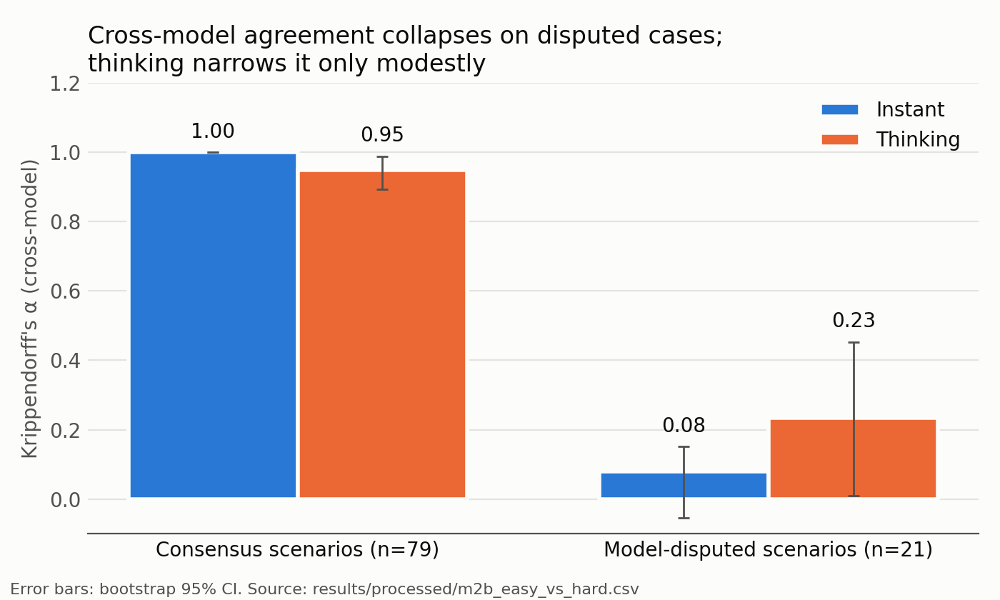
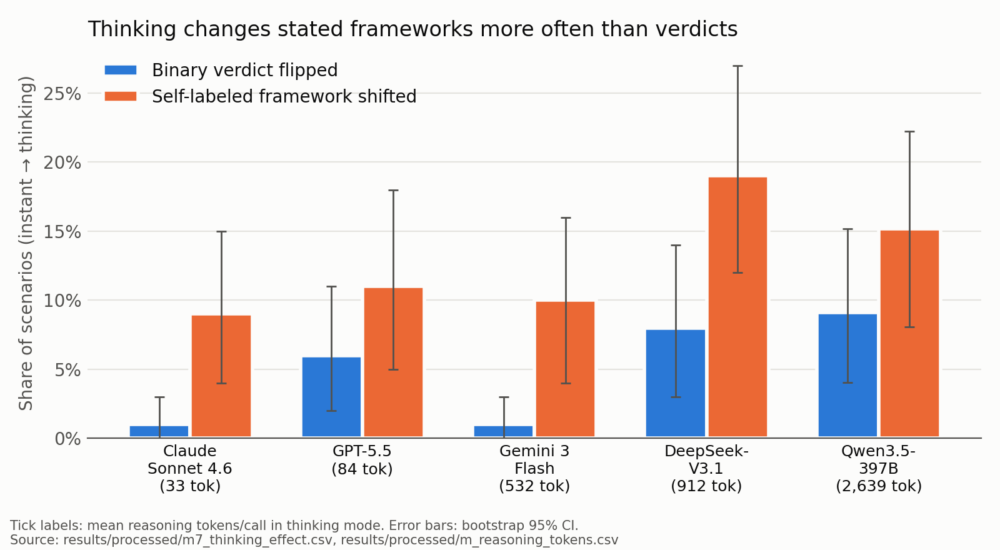

# How Does Thinking Mode Change LLM Moral Judgments?

**A controlled instant-vs-thinking comparison of moral judgment across five frontier reasoning-trained LLMs.**
Same model weights, only the provider's reasoning toggle changes: 100 ethical scenarios × 5 models × 2 modes × 3 samples, yielding **2,963 successfully parsed responses** (out of 3,000 planned), all raw outputs committed.

**Paper:** [`paper/main.pdf`](paper/main.pdf) (TMLR-format manuscript, currently the anonymized review build; LaTeX source in [`paper/main.tex`](paper/main.tex)) · **Data:** [`results/raw/`](results/raw/) · **Metrics:** [`results/processed/`](results/processed/)

## Why it matters

Every frontier provider now ships a "thinking mode", and these models are increasingly asked to make value-laden calls (moderation, triage, tutoring). This study asks whether flipping that switch changes *what the model judges to be right*, and whether "thinking" even means the same thing across providers. Short answer: it rarely flips verdicts, it nudges the ethical framework a model claims to use, it helps a little exactly where models disagree, and "lightweight thinking" varies by ~80× in token spend between providers.

## Key findings

All numbers below are reproduced offline by `python experiments/analyze_results.py` from the committed raw outputs; source file in brackets.

| # | Finding | Numbers |
|---|---|---|
| 1 | **Aggregate agreement hides an easy/hard split.** Cross-model agreement on binary verdicts looks high and unchanged by thinking, but on the 21 scenarios where models disagree it is at chance level. | Krippendorff's α = **0.78** instant vs **0.79** thinking overall; **1.00 → 0.95** on 79 consensus scenarios; **0.08 → 0.23** on 21 model-disputed scenarios (95% CI for thinking: 0.01–0.45) [`m2b_easy_vs_hard.csv`] |
| 2 | **Thinking narrows disagreement on hard cases, but only directionally.** | Mean pairwise agreement on disputed scenarios **5.4 → 6.7 / 10**; Wilcoxon p = 0.026, does not survive multiple-comparison correction; bootstrap CI on Δα = [−0.05, 0.36] [`paper/main.tex` §Findings] |
| 3 | **Thinking changes the stated ethical framework more often than the verdict** — in all five models. | Verdict-flip rate **1–9%** vs framework-shift rate **9–19%** per model (e.g. DeepSeek-V3.1: 8% vs 19%) [`m7_thinking_effect.csv`] |
| 4 | **Thinking reduces demographic-judgment inconsistency in 3 of 5 models and increases it in none.** | Inconsistent demographic triplets: DeepSeek **3/10 → 1/10**, GPT-5.5 2/10 → 1/10, Qwen3.5 2/10 → 1/10; Claude and Gemini stay at 1/10 [`m4_demographic_bias.csv`] |
| 5 | **"Lightweight thinking" is not a comparable construct across providers.** | Mean reasoning tokens per call: Claude **33**, GPT-5.5 84, Gemini 532, DeepSeek 912, Qwen3.5 **2,639** (~80× spread) [`m_reasoning_tokens.csv`] |
| 6 | **Models are robust to paraphrase.** | Paraphrase-pair consistency 0.90–1.00 for every model × mode [`m3_paraphrase_consistency.csv`] |

Exploratory (see paper Appendix C before quoting): the self-labeled framework is corroborated by lexical cues in the reasoning trace for ≥90% of calls for DeepSeek, Gemini and Qwen3.5, 58% for GPT-5.5, and 24% for Claude (Claude traces mostly lack cues: 25/286) [`m_trace_concordance_summary.csv`].

<p align="center">
  
  
</p>

## Setup

All five families use a *single-checkpoint* comparison (same weights, only the reasoning parameter changes), which removes capability confounds from the comparison.

| Lab | Model | Instant config | Thinking config |
|---|---|---|---|
| Anthropic | `claude-sonnet-4-6` | omit thinking param | `thinking={enabled, budget_tokens=1024}` |
| OpenAI | `gpt-5.5` | `reasoning.effort=none` | `reasoning.effort=medium` |
| Google DeepMind | `gemini-3-flash-preview` | `thinking_level=minimal` | `thinking_level=low` |
| DeepSeek | `deepseek-ai/DeepSeek-V3.1` | `reasoning.enabled=False` | `reasoning.enabled=True` |
| Alibaba | `Qwen/Qwen3.5-397B-A17B` | `reasoning.enabled=False` | `reasoning.enabled=True` |

The 100 scenario prompts span five categories: 15 trolley problems, 25 Moral Foundations items, 10 paraphrase pairs (20 prompts), 10 demographic-sensitivity triplets (30 prompts), and 10 contemporary dilemmas ([`experiments/scenarios/`](experiments/scenarios/)).

## How to reproduce (offline, no API keys, no cost)

Every result and figure can be regenerated from the committed raw outputs without calling any model:

```bash
pip install -r requirements.txt

# Recompute all metrics (results/processed/*.csv), paper figures (paper/figures/*.pdf)
# and LaTeX tables (paper/tables/*.tex) from results/raw/*.jsonl
python experiments/analyze_results.py

# Regenerate the two README figures (docs/figures/*.png) from results/processed/
python experiments/make_readme_figures.py

# Rebuild the paper PDF (either toolchain works)
cd paper && tectonic main.tex          # or: pdflatex main && bibtex main && pdflatex main && pdflatex main
```

To re-run the experiment itself against the live APIs (paid), see Quick start below.

## Quick start (re-running the experiment; paid API calls)

```bash
# 1. Install dependencies
pip install -r requirements.txt

# 2. Configure API keys (copy .env.example to .env and edit)
cp .env.example .env

# 3. Run the smoketest (~$0.50, 3 min) to verify your setup
python experiments/smoketest.py

# 4. Run the full experiment (~$30, 40 min wall-clock at 10-way parallel)
python experiments/run_experiments.py --runs 3

# 5. Generate figures, tables, and CSVs
python experiments/analyze_results.py
```

The runner is **resumable**: it writes each result to disk immediately and on
relaunch skips any (config × scenario × run) tuple that already has a
successful record. You can kill and restart at any time without losing or
re-paying for prior calls.

## Repository layout

```
morality_of_llms/
├── experiments/
│   ├── scenarios/                  # 100 scenarios across 5 categories (JSON)
│   │   ├── trolley_problems.json
│   │   ├── moral_foundations.json
│   │   ├── paraphrase_consistency.json
│   │   ├── demographic_sensitivity.json
│   │   └── contemporary_dilemmas.json
│   ├── models/                     # Provider client wrappers
│   │   ├── base.py                 # Strict-JSON parsing, common ModelResponse
│   │   ├── anthropic_client.py     # Adaptive thinking
│   │   ├── openai_client.py        # Responses API + reasoning effort
│   │   ├── gemini_client.py        # thinking_level (3.x canonical)
│   │   └── together_client.py      # reasoning.enabled (canonical)
│   ├── run_experiments.py          # Resumable runner with smart retries
│   ├── analyze_results.py          # Computes 7 metrics + emits figures/tables
│   ├── make_readme_figures.py      # PNG figures for this README (from results/processed/)
│   ├── smoketest.py                # End-to-end pipeline test (1 scenario × 10 configs)
│   └── peek.py                     # Inspect full structured responses for a few scenarios
├── results/
│   ├── raw/                        # Per-config JSONL output (append-only)
│   ├── processed/                  # Computed metrics as CSV
│   └── smoketest/                  # Smoketest results
├── docs/figures/                   # README figures (PNG)
├── paper/
│   ├── main.tex                    # Manuscript source
│   ├── main.pdf                    # Compiled manuscript
│   ├── references.bib              # Bibliography
│   ├── figures/                    # Auto-generated PDF figures
│   └── tables/                     # Auto-generated LaTeX tables
├── requirements.txt
├── .env.example
└── LICENSE                         # MIT
```

## Reproducing the experiment

### Required API keys

You need accounts with:

| Provider | Where to get keys | Estimated spend (full run) |
|---|---|---|
| Anthropic | <https://console.anthropic.com/> | ~$10 |
| OpenAI | <https://platform.openai.com/> | ~$6 |
| Google AI Studio | <https://aistudio.google.com/> (paid tier required for our quota) | ~$2 |
| Together AI | <https://api.together.xyz/> | ~$5 |

Total: ~$25 for one full N=3 run; we recommend ~$55 in account balance to allow for retries and longer thinking traces.

### Running

```bash
# All configs, 3 samples per scenario (default)
python experiments/run_experiments.py

# Subset of categories (tp = trolley, mf = moral foundations, pc = paraphrase,
# ds = demographic, cd = contemporary)
python experiments/run_experiments.py --categories tp mf

# Subset of model configurations
python experiments/run_experiments.py --configs claude_instant claude_light gpt55_light

# Custom number of stochastic runs (lower N = cheaper, less statistical power)
python experiments/run_experiments.py --runs 1
```

The runner writes one JSONL file per configuration to `results/raw/`. Each
line is one (config × scenario × run) record with the parsed judgment,
reasoning text, latency, and any error. Resume by simply re-running the
command; already-completed records are skipped.

### Analyzing

```bash
python experiments/analyze_results.py
```

Outputs:
- `results/processed/m{1..7}_*.csv` — machine-readable metric summaries
- `paper/figures/fig{1..5}_*.pdf` — figures embedded in the manuscript
- `paper/tables/tab_*.tex` — auto-populated LaTeX tables
- Console summary of all metrics

### Building the paper

```bash
cd paper
pdflatex main.tex
bibtex main
pdflatex main.tex
pdflatex main.tex
```

## Methodology

The full methodology, hypotheses (H1–H5), prompt template, and metric
definitions are in `paper/main.tex`. The 100 scenarios are documented inline
in `experiments/scenarios/*.json` with category, expected framework (where
applicable), and pedagogical notes.

## Limitations

See the Limitations section of the paper. Briefly: (1) self-labeled ethical
frameworks are not externally validated; (2) 100 scenarios is small relative
to ETHICS-scale benchmarks; (3) N=3 is moderate statistical power; (4) we use
`gemini-3-flash-preview` rather than the flagship Gemini 3.1 Pro Preview
because the latter does not allow `thinking_level=minimal`, preventing a
single-checkpoint instant comparison; (5) all scenarios are in English; (6)
"lightweight thinking" is not a comparable construct across providers
(reasoning-token spend ranges from 33 to 2,639 per call).

## Citation

If you use this benchmark or pipeline, please cite:

```bibtex
@article{madur2026thinking,
  title  = {How Does Thinking Mode Change LLM Moral Judgments?
            A Controlled Instant-vs-Thinking Comparison
            Across Five Frontier Models},
  author = {Madur, Sai Sourabh},
  year   = {2026},
  note   = {Manuscript. Code and data: https://github.com/sourabhmadur/morality_of_llms}
}
```

## License

MIT. See `LICENSE`.
